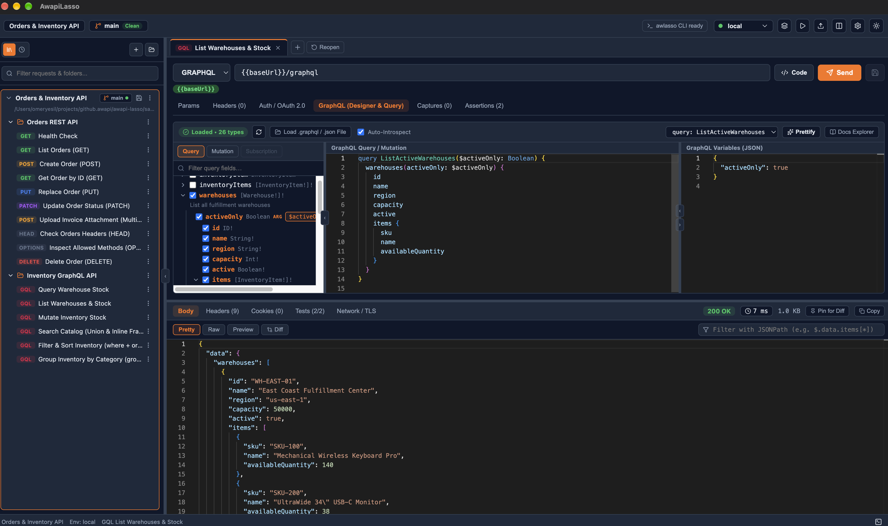

# AwapiLasso

[](https://github.com/awapi/awapi-lasso/actions/workflows/ci.yml)
[](https://github.com/awapi/awapi-lasso/actions/workflows/release.yml)

**AwapiLasso** is a fast, lightweight, local-first HTTP, RESTful, and GraphQL API client built for native cross-platform execution across **macOS, Windows, and Linux**.



---

## ✨ Key Highlights

- **Cross-Platform Native App:** Runs seamlessly on **Windows** (`.exe` NSIS & `.msi`), **macOS** (`.dmg` for Apple Silicon & Intel), and **Linux** (`.AppImage` & `.deb`).
- **Universal API Support:** First-class support for **RESTful APIs**, arbitrary **HTTP/HTTPS** requests, and **GraphQL** (including automatic **Schema Discovery**, an interactive **Visual Query Designer** with two-way AST sync, **Schema Explorer**, and split Query/Variables editors).
- **Single-File YAML Collections (`.awjc` & `.awj`):** Save each collection—including nested folders, requests, auth profiles, and environments—locally in a clean, human-readable `.awjc` YAML file (with full JSON compatibility). Easy to share and Git-friendly.
- **Click-to-Open OS Integration:** Double-click any `.awjc` or `.awj` collection file in macOS Finder, Windows Explorer (or via the right-click *"Open with AwapiLasso"* context menu), or Linux file manager to open it directly in AwapiLasso.
- **Environments, `{{Variables}}` & Secrets:** Pass `{{baseUrl}}`, `{{token}}`, `{{userId}}`, and dynamic variables (`{{$uuid}}`, `{{$timestamp}}`, `{{$isoTimestamp}}`) into URLs, query/path parameters, headers, auth settings, request bodies, and GraphQL queries. Secret variables (passwords, API keys, client secrets, tokens) are protected in the OS Keychain (`safeStorage`) or a gitignored local sidecar—never leaked in plaintext inside `.awjc` files.
- **Built-in OAuth 2.0 Token Manager:** Acquire, inspect (with decoded JWT preview), cache, and auto-refresh tokens from OAuth 2.0 endpoints using **Password (`password`)**, **Client Credentials (`client_credentials`)**, **Authorization Code (`authorization_code` + PKCE)**, and **Refresh Token (`refresh_token`)** flows.

---

## 🧰 Features & Capabilities

| Area | What you get |
|------|--------------|
| **REST / HTTP Client** | All HTTP methods, bi-directional URL ↔ query-params editor, path variables, headers editor, and JSON/YAML/XML/text, form-urlencoded, multipart, and binary bodies in a Monaco editor. |
| **GraphQL Query Builder** | Live introspection or offline SDL/JSON schema import, a point-and-click **Visual Query Designer** with two-way sync to the editor, Schema Explorer, and schema-aware autocomplete and validation. |
| **Collections** | Multi-collection sidebar with search, drag-and-drop, and folders; saved as single-file `.awjc` / `.awj` YAML; external-change watcher; session restore on startup. |
| **Git Integration** | Per-collection source control: status, diff, log, branch checkout, commit, pull, push, and revert, with secrets kept out of Git via an auto-managed `.gitignore`. |
| **Integrated Terminal** | Built-in multi-session terminal panel (View menu) with your choice of shell and font, so you can run `git`, `curl`, or scripts next to your requests. |
| **Environments & Secrets** | Unlimited environments per collection, `{{variable}}` interpolation everywhere, dynamic variables, hover inspection, and OS Keychain-protected secrets. |
| **Authentication** | Collection → folder → request inheritance; Bearer, Basic, API Key, Digest, AWS Signature v4; built-in OAuth 2.0 (password, client credentials, auth code + PKCE, refresh) with JWT decoding. |
| **Response Inspector** | Status, timing breakdown, pretty/raw/preview views, JSONPath filter, response diff, pin & copy. |
| **Captures & Assertions** | Extract values from responses into variables to chain requests, and verify status, time, headers, and JSONPath. |
| **Collection Runner** | Run a collection or folder sequentially with pass/fail results. |
| **Import & Code Generation** | Import cURL, OpenAPI, Swagger, and Postman; generate code snippets from any request. |
| **Request History** | Browse past requests and restore them in one click. |

See the full list in [**Features & Roadmap (`docs/features.md`)**](docs/features.md).

---

## 📥 Installing from GitHub Releases

Download the latest installer for your OS from the [Releases page](https://github.com/awapi/awapi-lasso/releases/latest):

| OS | Installer | Notes |
|----|-----------|-------|
| **macOS** | `AwapiLasso-<version>-arm64.dmg` | Apple Silicon. Drag to `/Applications`, then run `xattr -cr /Applications/AwapiLasso.app` once (see below). |
| **Windows** | `AwapiLasso-<version>-x64-setup.exe` (NSIS) or `AwapiLasso-<version>-x64.msi` | Run the installer. If SmartScreen warns, click **More info → Run anyway** (builds are not code-signed). |
| **Linux (Debian/Ubuntu)** | `AwapiLasso-<version>-amd64.deb` | `sudo apt install ./AwapiLasso-<version>-amd64.deb` |
| **Linux (any distro)** | `AwapiLasso-<version>-x86_64.AppImage` | `chmod +x AwapiLasso-<version>-x86_64.AppImage && ./AwapiLasso-<version>-x86_64.AppImage` |

### macOS: "AwapiLasso Not Opened" / "Apple could not verify…"

Release builds are not yet signed/notarized with an Apple Developer ID, so Gatekeeper blocks the first launch. To fix it:

1. Open the `.dmg` and drag `AwapiLasso.app` to `/Applications`.
2. Remove the quarantine attribute (once):
   ```bash
   xattr -cr /Applications/AwapiLasso.app
   ```
3. Launch AwapiLasso normally.

Alternatively: click **Done** in the dialog, then go to **System Settings → Privacy & Security**, scroll to the *Security* section, and click **Open Anyway** next to "AwapiLasso was blocked".

### macOS: "AwapiLasso wants to use your confidential information stored in “AwapiLasso Safe Storage” in your keychain"

This prompt is expected and **does not give AwapiLasso access to your other keychain items** (Wi-Fi, browser, or other apps' passwords).

- "AwapiLasso Safe Storage" is a keychain entry created by AwapiLasso itself (via Electron's `safeStorage`). It holds a single random encryption key used to encrypt your collection secrets (passwords, API keys, OAuth 2.0 tokens) before they are saved locally.
- The app never lists or reads any other keychain entry.
- macOS shows the prompt because the build is unsigned (see above), so its code signature is not recognized as the one that created the entry. Enter your **login keychain password** and click **Always Allow** to stop it from appearing again. Other Electron apps (VS Code, Slack, Discord, Chrome) show the same prompt for the same reason.
- Click **Deny** if you prefer: the app still works, but saved secrets cannot be decrypted. If secure storage is unavailable, AwapiLasso refuses to save secrets rather than storing them unencrypted.

---

## 🛠️ Local Development, Packaging & Releasing on GitHub

### 1. Local Development & Testing
```bash
# Install dependencies
just install        # or: pnpm install

# Start the app in dev mode + local Sample REST/GraphQL/OAuth2 API on port 8080
just dev            # or: pnpm run dev

# Run strict TypeScript check and Vitest suite
just typecheck      # or: pnpm run typecheck
just test-once      # or: pnpm run test
```

### 2. Generate Local Installation Packages (Current OS)
To build the production bundle and package the native installer locally into `release/` without publishing to GitHub:
```bash
# Builds the installer into release/ (and opens the .dmg window on macOS)
just package        # or: pnpm run package
```
- **macOS:** `release/AwapiLasso-<version>-<arch>.dmg` (After dragging `AwapiLasso.app` to `/Applications`, run `xattr -cr /Applications/AwapiLasso.app` once to clear Gatekeeper quarantine).
- **Windows:** `release/AwapiLasso-<version>-<arch>-setup.exe` (NSIS) and `.msi`.
- **Linux:** `release/AwapiLasso-<version>-<arch>.AppImage` and `.deb`.

### 3. Build Multi-OS Installers & Publish Releases on GitHub
Cross-platform installers (macOS `.dmg`, Windows `.exe`/`.msi`, Linux `.AppImage`/`.deb`) are built in parallel on GitHub Actions ([`.github/workflows/release.yml`](.github/workflows/release.yml)).

#### Option A — From Terminal via `just` (Recommended)
Requires the [GitHub CLI (`gh`)](https://cli.github.com/) authenticated (`gh auth login`). Choose a new version number (e.g., `0.1.1` or `0.2.0`):
```bash
# 1. Cut a Draft Release on GitHub (bumps package.json, commits, tags v0.1.1, and pushes to trigger GitHub Actions):
just release 0.1.1

# 2. Once the "Release Builds" GitHub Action finishes, publish the draft as Latest:
just publish 0.1.1

# Or do both in one command (waits for GitHub Actions to finish and auto-publishes):
just release 0.1.1 publish
```

#### Option B — Directly in the GitHub Web UI
1. **Trigger the Build:** Go to **GitHub → Actions → [Release Builds](https://github.com/awapi/awapi-lasso/actions/workflows/release.yml)** → click **Run workflow** → select `main` → click **Run workflow**.
2. **Publish the Release:** Once the macOS, Windows, and Linux jobs complete, go to **GitHub → [Releases](https://github.com/awapi/awapi-lasso/releases)**, edit the generated **Draft** release, check **"Set as the latest release"**, and click **Publish release**.

---

## 📚 Documentation & Specifications

- 📋 [**Product & Technical Requirements (`docs/requirements.md`)**](docs/requirements.md) — Complete functional & non-functional requirements, architecture, and security model.
- 📄 [**`.awjc` / `.awj` Collection File Format Spec (`docs/file-format-spec.md`)**](docs/file-format-spec.md) — Annotated YAML schema, OAuth 2.0 & environment configurations, secret handling, and OS file associations.
- 🤖 [**AI / LLM Authoring Guide (`docs/ai-authoring-guide.md`)**](docs/ai-authoring-guide.md) — Point an AI agent here to generate `.awjc` collections (REST & GraphQL) with correct structure and no plaintext secrets.
- 🗺️ [**Features & Roadmap (`docs/features.md`)**](docs/features.md) — Full feature breakdown of what AwapiLasso does and its planned roadmap.
- 🚀 [**Release, Packaging & CI/CD Process (`docs/release-process.md`)**](docs/release-process.md) — GitHub Actions workflows, Windows/macOS/Linux installer configurations, and `justfile` release automation.
- 🧭 [**Agent Instructions (`AGENTS.md`)**](AGENTS.md) — Project conventions, Electron Main/Preload/Renderer boundaries, and mandatory testing rules.

---

## 📄 License

This project is licensed under the [Apache License 2.0](LICENSE).